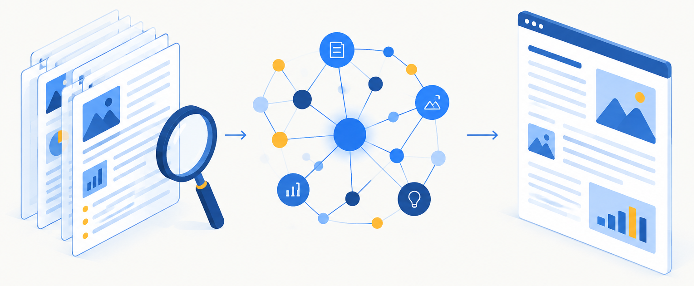
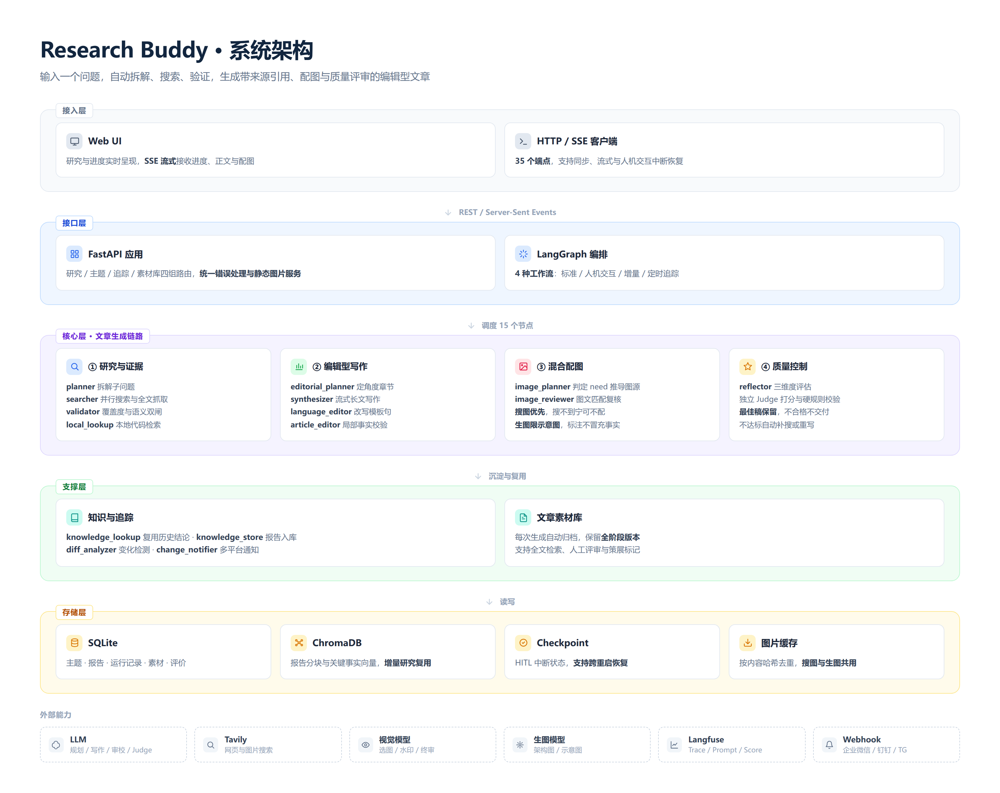
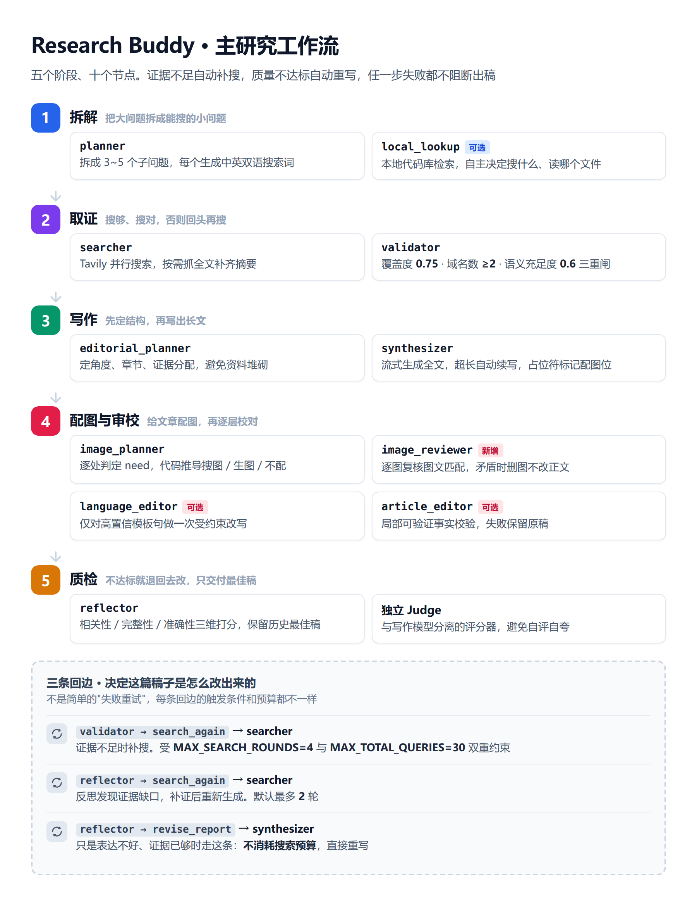

# 🔍 Research Buddy

基于 LangGraph + Langfuse 的深度研究 Agent。输入一个问题，自动拆解、搜索、验证，生成一篇带来源引用、配图和质量评审的编辑型文章。

  



## ✨ 功能特点

**研究工作流**
- **智能拆解** — LLM 将研究问题拆解为 3-5 个子问题，生成自适应语言的搜索词
- **并行搜索** — Tavily API 并行搜索，支持多轮补充搜索
- **交叉验证** — 确定性硬闸（覆盖度/域名多样性）+ LLM 语义软闸双重校验
- **本地检索** — 可选 agentic 自主循环：自主 web 搜索、抓网页全文、读本地代码库
- **自我反思** — LLM 评估质量，不达标时补充搜索后重新生成

**编辑型文章管线**
- **编辑规划** — 先定写作角度、章节结构和证据分配，再动笔
- **流式写作** — 支持超长文自动续写（服务商截断时）
- **事实审校** — 局部可验证事实校验，失败时保留原稿
- **语言审校** — 仅对高置信模板句做一次受约束改写

**配图（搜图 + 生图混合）**
- **逐处决策** — LLM 判断每个子问题需要什么配图，但**配图类型不由 LLM 指定**，而是从需求结构性推导（详见下文）
- **搜图优先** — 真实资产、真实数据图表只搜图；**搜不到就不配图，绝不生成**
- **生图补位** — 仅用于机制示意图与装饰配图，题注统一标注「示意图」
- **水印防护** — 下载后视觉复核逐字抄写画面文字，命中叠加内容即丢弃
- **配图终审** — 文章写完后逐图复核图文是否匹配，矛盾时删图而非改正文

**工程能力**
- **知识层** — SQLite + ChromaDB 增量研究，复用历史结论
- **定时追踪** — APScheduler 定时重跑，DiffAnalyzer 检测变化，多平台 Webhook 通知
- **文章素材库** — 每次生成自动归档，支持全文查询、阶段版本、人工评审
- **质量评测** — LLM-as-Judge 自动评分 + A/B 回归对比
- **可观测性** — Langfuse 全链路 Trace、评分、Prompt 版本管理
- **Web UI** — 深色主题，SSE 流式，支持 HITL 中断确认

## 🏗️ 架构

### 系统架构



<sub>源码：[docs/diagrams/html/architecture.html](docs/diagrams/html/architecture.html)。改完运行 `npm run docs:diagrams` 重新出图。</sub>

五层结构：**接入层**（Web UI 与 HTTP/SSE 客户端）→ **接口层**（FastAPI 路由与 LangGraph 编排）→ **核心层**（研究与证据 → 编辑型写作 → 混合配图 → 质量控制）→ **支撑层**（知识与追踪、文章素材库）→ **存储层**（SQLite、ChromaDB、Checkpoint、图片缓存）。右侧虚线框是外部依赖，缺任何一个都有降级路径。

### 主研究工作流



<sub>源码：[docs/diagrams/html/workflow.html](docs/diagrams/html/workflow.html)。节点与 `graph.py` 的 `_add_core_nodes_and_edges` 一一对应。</sub>

六个阶段、十个节点：**拆解 → 取证 → 写作 → 配图 → 审校 → 质检**。其中 `local_lookup`、`language_editor`、`article_editor` 为可选增强，未配置或失败时直接跳过，不影响出稿。

底部三条回边决定了稿子是怎么改出来的：`validator` 补搜受 `MAX_SEARCH_ROUNDS=4` 与 `MAX_TOTAL_QUERIES=30` 双重约束；`reflector` 发现证据缺口时回到 `searcher` 补证（默认最多 2 轮）；只是表达不好、证据已够时走 `revise_report` 直接重写，**不消耗搜索预算**。

### 四种工作流

| 图 | 入口 | 说明 |
|---|---|---|
| `create_research_graph()` | 标准研究 | 10 个节点，从规划到反思 |
| `create_research_graph_with_hitl()` | 人机交互 | 在 `searcher`（确认子问题后开始搜索）和 `reflector`（补充要求后重新评估）前中断，默认内存 MemorySaver，可换 SqliteSaver 持久化 |
| `create_knowledge_research_graph()` | 增量研究 | 前置 `knowledge_lookup` 查历史，后置 `knowledge_store` 入库 |
| `create_tracking_graph()` | 定时追踪 | 在增量研究基础上追加 `diff_analyzer` + `change_notifier` |

### 配图的分工原则

这是本项目的核心设计之一，**不由 LLM 自由决定用哪种图**。`image_planner` 让 LLM 判断「这里需要什么样的图」（`need`），再由代码映射到图片来源（`kind`）：

| need | 含义 | 来源 |
|---|---|---|
| `real_asset` | 产品界面、官方公告、定价页、人物、现场 | 搜图 |
| `data_viz` | 真实数值的对比/趋势/基准成绩 | 搜图 |
| `structure` | 流程图、架构图、模块关系、状态机 | 生图 |
| `decorative` | 概念意象、章节头图 | 生图 |
| `none` | 不需要配图 | 跳过 |

**为什么搜图需求永不回退到生图**：为带事实属性的内容生成一张「看起来像官方公告」或「看起来像基准图表」的图，等于伪造证据。搜索失败时正确的做法是不配图，而不是编一张。

**为什么 kind 不让 LLM 选**：早期版本让 LLM 同时输出 `reason` 和 `kind`，出现过 `reason` 写着「必须搜索真实图表」而 `kind=generate` 的自相矛盾。改成从 `need` 推导后，这类冲突在结构上不可能发生。

## 📁 项目结构

```
research-buddy/
├── src/research_buddy/
│   ├── graph.py                 # 4 种 LangGraph 工作流
│   ├── state.py                 # State 定义（TypedDict + operator.add 追加语义）
│   ├── config.py                # 环境变量配置
│   ├── api.py                   # FastAPI（HTTP + SSE + HITL + 静态文件）
│   ├── archive.py               # 文章素材库归档
│   ├── styles.py                # 写作风格定义
│   ├── utils.py                 # 通用工具（JSON 解析、状态合并等）
│   ├── nodes/
│   │   ├── planner.py           #   规划 — 拆解子问题，生成搜索词
│   │   ├── searcher.py          #   搜索 — 并行搜索 + 全文抓取
│   │   ├── validator.py         #   验证 — 覆盖度/多样性/语义三重校验
│   │   ├── local_lookup.py      #   本地检索 — agentic 自主研究循环
│   │   ├── editorial_planner.py #   编辑规划 — 角度、章节、证据分配
│   │   ├── image_planner.py     #   配图规划 — need→kind 结构性推导
│   │   ├── synthesizer.py       #   综合 — 流式长文写作
│   │   ├── image_reviewer.py    #   配图终审 — 图文匹配复核
│   │   ├── language_editor.py   #   语言审校 — 模板句改写
│   │   ├── article_editor.py    #   事实审校 — 局部事实校验
│   │   ├── reflector.py         #   反思 — 质量评估与改进建议
│   │   ├── knowledge_lookup.py  #   知识查询 — 复用历史结论
│   │   ├── knowledge_store.py   #   知识存储 — 报告入库
│   │   ├── diff_analyzer.py     #   变化分析 — 追踪场景
│   │   └── change_notifier.py   #   变化通知 — 多平台 Webhook
│   ├── tools/
│   │   ├── search.py            #   Tavily API 搜索
│   │   ├── images.py            #   搜图、下载、视觉选图、水印复核、缓存
│   │   ├── image_gen.py         #   生图（/images/generations）
│   │   ├── web.py               #   网页全文抓取
│   │   └── local.py             #   本地代码检索（grep/read/shell/exec）
│   ├── knowledge/               # SQLite + ChromaDB 知识层
│   ├── tracking/                # APScheduler + Diff + Notifier
│   ├── eval/                    # 数据集、Judge、Prompt 管理、质量回归
│   └── static/                  # Web UI（index.html + app.css + js/）
├── scripts/
│   ├── dev.sh                   # 启动/停止/重启/状态
│   ├── run_api.py               # 启动 API 服务
│   ├── run_eval.py              # Langfuse 评估
│   ├── run_article_eval.py      # 文章质量 A/B 回归
│   ├── run_process_eval.py      # 生成过程评测
│   ├── audit_image_watermarks.py# 存量配图水印审计
│   ├── render_diagrams.js       # 产品架构图/工作流图（HTML → PNG）
│   ├── render_architecture_diagrams.js # 内部文档的 Mermaid 图（SVG）
│   └── test_phase{1,2,3}.py     # 分阶段手工验证
├── tests/                       # 444 个单元测试 + Playwright e2e
├── docs/                        # 见下方「文档索引」
│   ├── assets/                      # 渲染产物（PNG + SVG）
│   ├── diagrams/                    # 图源：html/ 为产品图，*.mmd 为 Mermaid
│   ├── editorial-pipeline.md        # 编辑型管线与配图设计
│   ├── article-archive.md           # 文章素材库
│   ├── article-quality-evaluation.md # 质量回归评测
│   ├── architecture.md              # 架构总览
│   ├── knowledge-tracking-design.md # 知识层与追踪设计
│   └── learning-notes.md            # 学习笔记
├── spec/global/                 # 项目全局约束与特性索引
├── pyproject.toml               # 依赖管理（uv）
├── package.json                 # 前端测试与文档图表工具
└── Dockerfile                   # Docker 部署
```

### 文档索引

| 文档 | 内容 |
|---|---|
| [editorial-pipeline.md](docs/editorial-pipeline.md) | 编辑型文章管线、搜图/生图分工、配图终审设计 |
| [article-archive.md](docs/article-archive.md) | 文章素材库数据模型与接口 |
| [article-quality-evaluation.md](docs/article-quality-evaluation.md) | A/B 质量回归评测流程 |
| [architecture.md](docs/architecture.md) | 系统架构总览 |
| [knowledge-tracking-design.md](docs/knowledge-tracking-design.md) | 知识层与定时追踪设计 |
| [learning-notes.md](docs/learning-notes.md) | 构建过程学习笔记 |

## 🚀 快速开始

### 1. 安装依赖

```bash
# 需要 Python 3.11+ 和 uv
pip install uv

git clone https://github.com/JerryZ01/research-buddy.git
cd research-buddy

uv sync
```

### 2. 配置环境变量

```bash
cp .env.example .env
```

最小可用配置：

```env
# LLM — 任何 OpenAI 兼容 API
OPENAI_API_KEY=sk-xxx
OPENAI_API_BASE=https://api.openai.com/v1
OPENAI_MODEL=gpt-4o

# 搜索 — 必填（https://tavily.com 注册，免费 1000 次/月）
TAVILY_API_KEY=tvly-xxx

# Langfuse 可观测性（可选）
LANGFUSE_PUBLIC_KEY=pk-xxx
LANGFUSE_SECRET_KEY=sk-xxx
LANGFUSE_HOST=https://cloud.langfuse.com
```

> **`TAVILY_API_KEY` 是必填的**。缺失或搜索层连续失败时，研究会直接中止并报明确错误，而不是让模型凭内部知识编一份零来源的报告。

#### 2.1 可选：开启配图

配图**默认关闭**。留空 `VISION_MODEL` 时行为与无图版本完全一致。

```env
# 视觉选图 — 需要支持 vision 的模型
VISION_MODEL=<你的多模态模型>
# 默认复用 OPENAI_API_KEY / OPENAI_API_BASE，需要独立的视觉服务时单独指定
# VISION_API_KEY=sk-xxx
# VISION_API_BASE=https://your-vision-endpoint/v1

# 生图 — 走 OpenAI 兼容的 POST /images/generations
IMAGE_GEN_MODEL=<你的生图模型>
IMAGE_GEN_API_KEY=sk-xxx
IMAGE_GEN_API_BASE=https://your-image-endpoint/v1
# 留空则由服务端取默认尺寸
IMAGE_GEN_SIZE=
MAX_GENERATED_IMAGES=4
```

模型名、可用尺寸、单张耗时都取决于你用的服务商，以它的文档为准。`IMAGE_GEN_SIZE` 留空则不传该字段，由服务端取默认尺寸。生图通常需要数十秒，`IMAGE_GEN_TIMEOUT` 默认 180 秒，一般够用。

配图数量受 `MAX_IMAGES_IN_ARTICLE`（默认 10）和 `MAX_GENERATED_IMAGES`（默认 4）双重约束。

#### 2.2 可选：中文向量检索

知识层默认用 ChromaDB 内置的 `all-MiniLM-L6-v2`，英文语料训练，中文召回偏低。需要中文检索质量时选一个后端：

```env
# 本地多语言模型（质量好，但会拉入 torch，安装体积 +2~3GB）
EMBEDDING_BACKEND=sentence-transformers

# 或走 OPENAI_API_BASE 的 /embeddings（零安装体积，中转站不一定支持）
EMBEDDING_BACKEND=openai
```

```bash
uv sync --extra multilingual
```

后端不可用时打 WARNING 并降级到默认模型，不会静默切换。**切换后端后已有向量库不能混用**（都是 384 维，混用不报错但结果失去意义）：要么改回原模型，要么删掉 `data/chroma_db` 重建。

#### 2.3 可选：本地代码检索

```env
LOCAL_REPO_ROOT=/path/to/your/repo   # 留空且 LOCAL_AUTO_ROOT=true 时用启动目录
LOCAL_AGENTIC_ENABLED=true           # agentic 自主研究循环
LOCAL_AGENTIC_SHELL_ENABLED=false    # 只读 shell 白名单（默认关）
LOCAL_AGENTIC_EXEC_ENABLED=false     # 执行验证（默认关）
```

`SHELL` / `EXEC` 两项默认关闭，需要**显式开启**。

### 3. 启动服务

```bash
./scripts/dev.sh           # 启动（自动杀旧进程）
./scripts/dev.sh stop      # 停止
./scripts/dev.sh restart   # 重启
./scripts/dev.sh status    # 状态
```

浏览器打开 http://localhost:8000 。

## 🧪 测试

```bash
# 单元测试（全离线，不消耗 API）
uv run pytest -q

# 前端真实浏览器测试（首次需 npm install）
npm install
npm run test:e2e

# 若无可用 Chromium
npx playwright install chromium
```

当前 **444 个测试**。本地检索有一个 `test_exec_verification_allows_verification_commands` 在缺少 `python` 命令的环境下会失败，可用 `--deselect` 跳过。

会实际调用 LLM 的回归评测：

```bash
# 文章质量 A/B 回归（先跑 --limit 1 --samples 1 估算费用）
uv run python scripts/run_article_eval.py \
  --candidate-rules eval/prompts/candidate-v1.md \
  --limit 1 --samples 1

# Langfuse 评估
uv run python -m research_buddy.eval.dataset   # 首次：创建测试集（8 题）
uv run python scripts/run_eval.py
```

```bash
# 分阶段手工验证
uv run python scripts/test_phase1.py   # 规划→搜索→综合
uv run python scripts/test_phase2.py   # 验证→反思→补充搜索
uv run python scripts/test_phase3.py   # 人机交互
```

程序测试与文章质量评测用途不同。后者冻结搜索证据，对 baseline/candidate 多次采样，生成本地 JSON 和 HTML 对比报告，详见 [质量回归评测](docs/article-quality-evaluation.md)。

前端测试默认用 Playwright 管理的 Chromium，也会自动查找 `~/.cache/puppeteer/chrome`。指定其他浏览器：

```bash
PLAYWRIGHT_CHROMIUM_EXECUTABLE_PATH=/path/to/chrome npm run test:e2e
```

## 🔌 API 接口

### 研究

| 方法 | 路径 | 说明 |
|------|------|------|
| GET | `/health` | 健康检查 |
| POST | `/research` | 同步研究（等待完整报告） |
| POST | `/research/stream` | SSE 流式研究 |
| GET | `/research/stream?question=xxx` | SSE 流式研究（query 参数） |
| GET | `/research/run/{run_id}` | 查询运行结果 |
| POST | `/research/refine-question` | AI 润色研究问题（多候选） |
| POST | `/research/knowledge` | 增量研究（复用历史知识） |
| POST | `/research/knowledge/stream` | SSE 增量研究 |

### 人机交互（HITL）

| 方法 | 路径 | 说明 |
|------|------|------|
| POST | `/research/hitl/stream` | 启动可中断的研究 |
| POST | `/research/hitl/resume/stream` | 从中断点恢复 |
| GET | `/research/hitl/state` | 查询中断状态 |

### 文章素材库

| 方法 | 路径 | 说明 |
|------|------|------|
| GET | `/articles` | 文章列表 |
| GET | `/articles/{article_id}` | 文章详情（含阶段版本） |
| PATCH | `/articles/{article_id}/curation` | 更新策展标记 |
| POST | `/articles/{article_id}/reviews` | 提交人工评审 |

### 主题与追踪

| 方法 | 路径 | 说明 |
|------|------|------|
| POST/GET | `/topics` | 创建/列出追踪主题 |
| GET/PUT/DELETE | `/topics/{topic_id}` | 主题详情/更新/删除 |
| GET | `/topics/{topic_id}/reports` | 主题下的历史报告 |
| GET/DELETE | `/reports/{report_id}` | 报告详情/删除 |
| POST | `/tracking/run` | 手动触发追踪 |
| GET | `/tracking/jobs` | 定时任务列表 |
| GET | `/topics/{topic_id}/tracking-logs` | 追踪日志 |
| GET | `/tracking-logs/{log_id}/changes` | 变化详情 |
| POST | `/tracking/test-notification` | 测试 Webhook |

### SSE 事件类型

| 事件 | 说明 |
|---|---|
| `progress` | 节点进度 |
| `message` | 详细进度消息（如「配图规划完成：搜图 4 处、生图 1 处」） |
| `agent_step` | agentic 本地研究循环的单步决策 |
| `report_chunk` | 报告增量片段（流式写作） |
| `report_reset` | 报告重置（续写或重写时先清空前端缓冲） |
| `report` | 研究报告（完整 Markdown） |
| `interrupt` | HITL 中断，等待用户确认后 resume |
| `done` | 研究完成 |
| `error` | 错误 |

```bash
curl -N "http://localhost:8000/research/stream?question=LangGraph%20和%20LangChain%20的区别"
```

## 🛠️ 技术栈

| 类别 | 技术 |
|------|------|
| 工作流编排 | LangGraph（StateGraph、条件边、循环、HITL、Checkpoint） |
| LLM | langchain-openai（OpenAI 兼容 API） |
| 搜索 | Tavily API |
| 网页抓取 | httpx + 正文提取 |
| 配图 | Tavily 图片搜索 + 视觉模型选图 + `/images/generations` 生图 |
| 知识层 | SQLite + ChromaDB |
| 定时任务 | APScheduler |
| 可观测性 | Langfuse（Trace、评分、Prompt 版本管理） |
| Web 框架 | FastAPI + SSE |
| 前端测试 | Playwright |
| 包管理 | uv |
| 部署 | Docker |

## 📖 构建历程

项目按阶段递进式构建，每阶段聚焦 LangGraph / Langfuse 的核心特性：

| 阶段 | 内容 | 学到 |
|------|------|------|
| Phase 1 | 线性图 + Langfuse 接入 | StateGraph、Node、State、Trace/Span |
| Phase 2 | 条件分支 + 循环修正 | Conditional Edge、Loop、验证/反思 |
| Phase 3 | Human-in-the-loop | interrupt_before、Checkpoint、Command(resume=) |
| Phase 4 | Langfuse 评估体系 | Dataset、LLM-as-Judge、Prompt Management |
| Phase 5 | 生产化 | FastAPI、SSE 流式、Docker 部署 |
| Phase 6 | 知识层 | SQLite、ChromaDB、增量研究 |
| Phase 7 | 定时追踪 | APScheduler、Diff 检测、Webhook 通知 |
| Phase 8 | 编辑型文章管线 | 编辑规划、事实审校、质量评测 |
| Phase 9 | 混合配图 | 搜图/生图分工、水印防护、配图终审 |

## 🐳 Docker 部署

```bash
docker build -t research-buddy .
docker run -d -p 8000:8000 --env-file .env research-buddy
```

## 📝 License

MIT
