# Research Buddy 架构说明

> 本文以 2026-09-01 的仓库代码为准，描述当前可运行实现，而不是早期路线图。
> 核心定位是：以证据为基础、带编辑审校和永久归档能力的深度研究与文章生成系统。

## 1. 架构目标

Research Buddy 不把文章质量完全寄托在单个写作 Prompt 上，而是把一次研究拆成四层职责：

1. **研究层**：拆解问题、搜索资料、验证证据覆盖度，并在必要时补搜。
2. **编辑层**：写作前生成证据账本和编辑简报，写作后做语言与事实审校。
3. **质量控制层**：独立 Judge、确定性硬规则、反思循环和历史最佳稿保护共同决定是否重写。
4. **资产层**：将每次生成、阶段版本、图片、评价与知识报告分别持久化，支持复用、比较和追踪。

当前架构遵循以下原则：

- 搜索证据与模型判断分离，零证据时不允许模型直接凭内部知识出稿。
- 写作、语言审校、事实审校和质量评判职责分离。
- LLM 输出必须经过结构校验；可由代码确定的内容尽量不交给模型决定。
- 新增编辑节点失败时保留原稿，不让辅助能力阻断文章交付。
- 知识库和文章素材库分离，未审核稿不会自动污染后续知识召回。
- 搜索、反思、续写和图片数量都有显式预算，避免无界循环和费用失控。

## 2. 总体架构图



[查看 Mermaid 源文件](diagrams/architecture-overview.mmd)

修改 `docs/diagrams/*.mmd` 后，运行 `npm run docs:diagrams` 可重新生成本文引用的全部 SVG。

图中 `Lookup`、`Store`、`Diff` 和 `Notify` 只出现在知识研究或追踪流程；普通研究从 `Plan` 开始，在 `Reflect` 后结束。图片实际在搜索结果中聚合候选，并在写作阶段前完成筛选和缓存，图中将其归入研究与写作之间的辅助能力。

## 3. 分层与模块

| 层 | 主要模块 | 职责 |
|---|---|---|
| 展示层 | `static/index.html`、`static/app.css`、`static/js/*.js` | 研究操作、SSE 展示、报告阅读、素材库、版本比较、导出 |
| API 层 | `api.py` | HTTP/SSE、请求校验、后台运行恢复、HITL、静态资源 |
| 编排层 | `graph.py`、`state.py` | LangGraph 节点、条件边、循环、共享状态、检查点 |
| 研究节点 | `planner.py`、`searcher.py`、`validator.py` | 问题拆解、并行搜索、证据充分性判断 |
| 编辑节点 | `editorial_planner.py`、`synthesizer.py`、`language_editor.py`、`article_editor.py` | 编辑简报、写作、续写、语言与事实审校、图片插入 |
| 质量节点 | `reflector.py` | 独立评分、确定性规则、补搜或重写决策、最佳稿恢复 |
| 知识与追踪 | `knowledge/*`、`tracking/*`、对应 nodes | 历史召回、增量研究、变化检测、定时追踪、通知 |
| 文章档案 | `archive.py`、`knowledge/db.py` | 每次生成、阶段稿、评审和策展状态永久保存 |
| 工具层 | `tools/search.py`、`tools/images.py`、`utils.py` | Tavily、图片下载与视觉筛选、LLM 和流式公共能力 |
| 评估层 | `eval/*`、`scripts/run_article_eval.py` | Langfuse 数据集、LLM-as-Judge、冻结证据 A/B 回归 |

### 3.1 技术栈

| 能力 | 实现 |
|---|---|
| 工作流 | LangGraph 1.x `StateGraph`、条件边、循环和 interrupt |
| 模型访问 | `langchain-openai`，支持 OpenAI 兼容 API |
| Web 服务 | FastAPI、Uvicorn、`sse-starlette` |
| 搜索 | Tavily Search API |
| 关系数据 | SQLite，WAL 模式、线程本地连接 |
| 向量检索 | ChromaDB，可选默认、本地多语言或 OpenAI Embedding |
| 定时任务 | APScheduler `AsyncIOScheduler` + CronTrigger |
| 可观测性 | Langfuse 4.x Trace、Generation、Score 和 Prompt 管理 |
| 前端测试 | Playwright + Chromium，桌面与移动视口 |
| Python 管理 | Python 3.11+、uv、hatchling |

## 4. LangGraph 工作流

### 4.1 核心研究图

`create_research_graph()` 是普通研究主流程：



[查看 Mermaid 源文件](diagrams/research-workflow.mmd)

这里存在两个闭环：

- **证据闭环**：`validator -> searcher`，用于补齐子问题证据。
- **成稿闭环**：`reflector -> searcher/synthesizer`，用于补证据或基于现有证据重写。

反思重写直接回到 `synthesizer`，随后仍会经过语言和事实审校；补搜后则重新验证证据，并重建证据账本和编辑简报。

### 4.2 知识研究图

`create_knowledge_research_graph()` 在核心图前后各增加一个节点：

```text
START -> knowledge_lookup -> 核心研究链 -> knowledge_store -> END
```

- `knowledge_lookup` 从 SQLite 和 ChromaDB 召回已有报告、关键事实与相关分块。
- 增量模式只规划缺失信息，并用历史来源 URL 去重。
- `knowledge_store` 将最终报告写入 SQLite，并把报告分块与关键事实写入 ChromaDB。
- `parent_report_id` 将增量报告串成版本链。

### 4.3 HITL 图

`create_research_graph_with_hitl()` 使用与核心图相同的节点，在以下位置中断：

```text
planner -> [interrupt before searcher] -> ... -> article_editor
        -> [interrupt before reflector] -> reflector
```

第一次中断允许用户编辑子问题；第二次中断允许用户审阅文章并添加修改要求。API 使用 `thread_id` 恢复会话，生产入口使用 `data/hitl_checkpoints.db` 持久化检查点，默认构图仍可使用 `MemorySaver`。

### 4.4 追踪图

`create_tracking_graph()` 在知识研究完成后继续执行：

```text
knowledge_store -> diff_analyzer -> change_notifier -> END
```

变化分析先做文本相似度预判，再通过 LLM 提取结构化变化；高等级变化或多个中等级变化才会触发 Webhook，减少噪声通知。

### 4.5 路由与预算

| 路由 | 决策 |
|---|---|
| `route_after_validation` | 无缺口则写作；有缺口且仍可搜索则补搜；搜索不可用、无新查询或预算耗尽则用现有证据写作 |
| `should_continue` | 反思通过或达到反思上限则结束；有证据缺口且搜索预算可用则补搜；否则基于现有证据重写 |
| `should_continue_to_store` | 与上一项相同，但终点是 `knowledge_store` |

默认预算：

- 搜索最多 `MAX_SEARCH_ROUNDS=4` 轮。
- 补搜查询最多 `MAX_TOTAL_QUERIES=30` 个；初始查询不计入该预算。
- 反思最多 `MAX_REFLECTION_ROUNDS=2` 轮。
- 单次正文如被提供商截断，默认最多自动续写 `MAX_ARTICLE_CONTINUATIONS=2` 次。
- `MAX_ARTICLE_TOKENS=0` 表示项目不主动限制正文输出 token，仍受模型提供商上限约束。

## 5. 核心节点职责

### 5.1 `planner`

- 将问题按复杂度拆为 1-6 个必要子问题。
- 为每个子问题生成稳定的 `sq_01` 等 ID，以及可包含多语言的搜索查询。
- 增量模式结合历史知识，只规划尚未覆盖的内容。
- LLM 输出解析失败时使用保守的单问题计划，而不是让工作流失去结构。

### 5.2 `searcher`

- 将初始查询和 `validation_gaps` 合并为搜索任务，以最多 4 个线程并行调用 Tavily。
- 从第二轮开始，高优先级补搜使用 `advanced` 深度。
- 使用规范化 URL 和内容 SHA-256 指纹双重去重。
- 增量模式过滤历史知识中已使用的来源。
- 聚合 Tavily 返回的图片 URL，形成追加语义的 `image_candidates`。
- 全部搜索失败且没有历史证据时抛出 `SearchUnavailableError`，终止生成。
- 全部搜索失败但已有证据或历史知识时显式降级，并阻止继续无意义补搜。

### 5.3 `validator`

证据验证由确定性硬闸和 LLM 语义评估共同组成：

- 每个子问题至少需要 2 条有效结果和 2 个不同域名。
- 内容过短、URL 重复或归属不明的结果不会提高覆盖度。
- 确定性覆盖度结合结果数量、独立域名和 Tavily 相关度。
- LLM 判断证据是否真正回答问题、是否存在冲突，以及下一步应搜什么。
- 语义评估服务整体不可用时，保留确定性结果并标记降级。
- 服务返回了结果但漏掉某个分支时，对该分支 fail closed，生成补搜缺口。

默认确定性阈值为 `MIN_EVIDENCE_COVERAGE=0.75`，语义软闸为 `MIN_SEMANTIC_COVERAGE=0.6`。

### 5.4 `editorial_planner`

这是写作质量前移的关键节点：

1. 代码按规范化 URL 去重，生成稳定的 `E1`、`E2` 证据账本。
2. 每条证据保留原始摘录、关联子问题、验证状态和冲突信息。
3. LLM 生成结构化编辑简报：文章意图、读者、核心判断、范围、必讲要点、章节职责、证据映射、禁止断言和结尾方式。
4. 代码删除无效证据编号并校验简报结构；失败时降级为直接写作。

反思仅重写文章时复用当前简报；补搜产生新证据后才重新生成账本和简报。

### 5.5 `synthesizer`

写作节点支持全新、增量和反思改稿三种 Prompt，并承担以下确定性收尾：

- 使用写作专用温度，其他判断节点保持低温度。
- 流式发送 `report_chunk`，前端实时展示正文。
- 检测提供商 `finish_reason` 和正文是否戛然而止，必要时自动续写并去除重叠片段。
- 对装饰性比喻、冒号模板标题做检测和受控改写。
- 从全部来源中筛选核心参考文献，最终编号和 Markdown 由代码渲染。
- 计算置信度和研究说明；这些元信息不混入文章正文。
- 生成 `synthesizer` 阶段的 `article_versions` 快照。

正文原则是直接可发布：不输出研究过程、内部证据编号、置信度说明或裸来源 URL。参考文献集中放在文末。

### 5.6 图片管线

图片是可选增强，不是文章成功的前置条件：

```text
Tavily 图片候选
  -> 下载尺寸、类型和大小校验
  -> 视觉模型判断相关性、可用性和水印（先抄写叠加内容，再判定 watermark_status）
  -> watermark_status 必须为 none 且 overlay 为空串
  -> 入选图逐张独立复核（一图一问，只问水印）
  -> 复核通过后按内容哈希缓存到 data/research-images
  -> 写作模型使用 [[IMAGE_n]] 占位符
  -> 代码恢复为 /media/research-images/... Markdown
```

关键约束：

- 单图下载上限 3 MB，最小尺寸 400 x 300，过滤极端宽高比。
- 水印检查用「先抄写叠加内容、再判定」的证据优先问法，而不是直接问「有没有水印」：封闭式分类会被模型敷衍成 `none`。写入和复核都 fail-closed——字段缺失、抄出叠加内容、调用失败一律拒绝。
- 视觉调用（选图 + 水印复核）共用一个全局并发闸门（`_VISION_SEMAPHORE`），该端点并发能力弱，闸门保证请求排队而不是互相挤挂。
- 水印、署名叠字、账号 ID、二维码、版权叠印以及疑似水印都拒绝使用。
- 单篇文章上限由 `MAX_IMAGES_IN_ARTICLE` 控制，默认 10、硬上限 12；实际预算根据编辑简报和候选分布动态收缩。
- 图片 URL 不交给写作模型手抄，只给稳定占位符，防止 URL 被改写。
- 本地缓存解决第三方防盗链和临时链接失效；FastAPI 将缓存目录挂载为 `/media/research-images`。
- Markdown 导出时，前端把站内相对图片地址转换为当前服务的绝对地址。

### 5.7 `language_editor`

- 确定性扫描“不是……而是……”、仪式化总结、读者指令、重复段首连接词等高置信模板表达。
- 没有候选句时不调用模型。
- 模型只能对扫描到的原句做局部替换，最多应用 8 处。
- 数字、英文术语、引用和 URL 必须在修改前后完全一致。
- 标题、列表、表格、代码块和参考文献不进入候选集。
- 失败时保留原稿，并保存审校阶段快照。

### 5.8 `article_editor`

- 对数字、工具行为、因果关系、具体建议、重复论证和越界断言做证据定向审校。
- 模型必须返回原文精确片段、替换文本和逐字存在的支持证据。
- 代码验证原文、证据编号和支持原句后才接受编辑。
- 非空替换还要经过独立 grounding verifier；复核失败时只保留不会引入新事实的纯删除。
- 上下文守卫拒绝造成悬空标点、连词、表格损坏或邻句重复的修改。
- 生产配置最多一轮，失败时保留已验证的修改或原稿。

### 5.9 `reflector`

反思并非只听从模型的 `pass` 字段，而是组合判断：

- 独立模型从完整性、准确性、清晰度三个维度各打 1-5 分。
- 总分至少 12，且任一维度不得低于 3。
- 未知 URL、未解决证据缺口、未处理用户反馈、模板腔和标题结构问题可强制判失败。
- `REFLECTOR_MODEL` 可与写作模型分离；Judge 不可用时标记 `reflection_judge_degraded`，继续执行确定性规则。
- 返回补充查询时，查询绑定到当前最弱的具体子问题，确保补搜结果能计入覆盖度。
- 每轮保存质量排名最高且证据签名、用户反馈一致的稿件；最后一轮变差时恢复历史最佳稿。

## 6. 状态模型

`ResearchState` 是所有图共享的 TypedDict。字段按生命周期分组如下：

| 分组 | 代表字段 |
|---|---|
| 输入与评测 | `question`、`style`、`writing_rules_override`、`eval_use_local_prompts` |
| 历史知识 | `topic_id`、`knowledge_context`、`known_source_urls`、`key_facts` |
| 规划与搜索 | `sub_questions`、`search_results`、`search_history`、`search_round`、`total_queries` |
| 证据质量 | `validation_gaps`、`evidence_assessments`、`evidence_ledger`、`stop_reason` |
| 写作与编辑 | `editorial_brief`、`report`、`language_edits`、`evidence_edits`、`article_versions` |
| 长文保护 | `writer_finish_reason`、`writer_continuations`、`report_feedback_signature` |
| 来源与图片 | `source_table`、`core_refs`、`image_candidates`、`selected_images` |
| 反思 | `reflection_score`、`reflection_pass`、`reflection_feedback`、`best_report*` |
| 追踪 | `detected_changes`、`similarity`、`tracking_log_id`、`notification_sent` |
| UI 消息 | `messages` |

LangGraph 合并状态时有两种语义：

- **追加**：`search_results`、`search_history`、`image_candidates`、`article_versions`、`messages`、`detected_changes`、`key_facts`。
- **覆盖**：`sub_questions`、`validation_gaps`、`evidence_assessments`、`evidence_ledger`、`editorial_brief`、`report`、`selected_images`、各审校结果。

新增列表字段时必须先决定它属于哪一种语义，并同步检查 SSE 累积逻辑；错误的 reducer 会导致旧缺口无法清空或历史证据被覆盖。

## 7. 数据与持久化边界

### 7.1 SQLite

默认数据库为 `data/research_buddy.db`，包含：

| 表 | 用途 |
|---|---|
| `topics` | 研究主题、追踪关键词、cron 和启用状态 |
| `reports` | 已进入知识体系的报告、来源、关键事实、增量父版本 |
| `tracking_logs` / `changes` | 定时追踪执行结果与结构化变化 |
| `runs` | 普通 SSE 后台运行状态，用于断线后查询结果 |
| `article_generations` | 每次生成的最终状态摘要、模型、配置、错误和策展状态 |
| `article_versions` | 写作、语言审校、事实审校、反思各阶段全文快照 |
| `article_reviews` | 人工或模型评价、维度分、问题标签和是否进入评测集 |

`Database` 使用线程本地连接、外键约束和 WAL；schema 在进程内只初始化一次，避免后台 SSE 线程反复抢 DDL 锁。

### 7.2 知识库与素材库为什么分离



[查看 Mermaid 源文件](diagrams/data-boundaries.mmd)

- 素材库强调**完整留痕**，普通研究、知识研究、SSE、HITL、CLI 和追踪运行都会归档。
- 知识库强调**可召回可信内容**，只有知识研究和追踪流程会写入。
- `curation_status` 支持 `raw`、`candidate`、`approved`、`excluded`，但批准文章当前不会自动进入 ChromaDB。
- 服务启动时会将旧 `reports` 幂等回填为 `knowledge_legacy` 素材记录。

### 7.3 ChromaDB

持久化目录为 `data/chroma_db`，包含两个 collection：

- `report_chunks`：报告按 500 字、100 字重叠分块。
- `key_facts`：报告提取出的关键事实。

Embedding 后端可选：

- `default`：ChromaDB 默认 `all-MiniLM-L6-v2`，英文效果优先。
- `sentence-transformers`：本地 `paraphrase-multilingual-MiniLM-L12-v2`，需安装可选依赖。
- `openai`：调用兼容服务的 `/embeddings`。

collection metadata 会记录实际模型。已有向量与新配置不一致时直接报错，避免同维度但不同模型的向量被静默混用。

### 7.4 图片与 HITL 文件

- `data/research-images/`：通过内容哈希命名的本地图片缓存。
- `data/hitl_checkpoints.db`：人工中断状态，允许服务重启后按 `thread_id` 恢复。

## 8. API 与流式协议

### 8.1 主要端点

| 分类 | 端点 | 用途 |
|---|---|---|
| 基础 | `GET /health` | 健康检查 |
| 普通研究 | `POST /research` | 同步返回完整结果 |
| 普通研究 | `GET/POST /research/stream` | SSE 流式运行 |
| 断线恢复 | `GET /research/run/{run_id}` | 查询后台运行状态或最终结果 |
| 问题优化 | `POST /research/refine-question` | 在开始研究前整理问题 |
| HITL | `POST /research/hitl/stream` | 创建人工确认研究 |
| HITL | `POST /research/hitl/resume/stream` | 提交编辑或反馈并恢复 |
| HITL | `GET /research/hitl/state` | 查询中断状态 |
| 知识研究 | `POST /research/knowledge` | 同步知识研究 |
| 知识研究 | `POST /research/knowledge/stream` | SSE 知识研究 |
| 主题 | `/topics`、`/topics/{id}`、`/topics/{id}/reports` | 主题与报告 CRUD |
| 素材库 | `GET /articles`、`GET /articles/{id}` | 列表、全文、版本和评价 |
| 素材库 | `PATCH /articles/{id}/curation` | 更新策展状态 |
| 素材库 | `POST /articles/{id}/reviews` | 添加人工或模型评价 |
| 追踪 | `/tracking/run`、`/tracking/jobs`、追踪日志与变化端点 | 手动追踪、任务和变化查询 |
| 图片 | `GET /media/research-images/*` | 本地缓存图片 |

### 8.2 SSE 事件

API 将 LangGraph 的 `updates`、`messages` 和 `custom` 流转换成前端事件。主要事件包括：

| 事件 | 含义 |
|---|---|
| `start` | 返回 `run_id` 或 `thread_id`，客户端可用于恢复 |
| `node_start` / `node_complete` | 节点开始、完成及结构化详情 |
| `message` | 面向用户的进度消息 |
| `report_chunk` | 写作模型增量正文 |
| `report_reset` | 审校或最佳稿恢复后清空当前展示并重放全文 |
| `interrupt` | HITL 到达人工确认点 |
| `report` | 最终完整结果，包括 `article_id` |
| `done` / `error` | 运行完成或失败 |

普通 SSE 请求启动后由后台线程继续运行。浏览器断开不会取消研究，`runs` 表保存状态，前端可轮询 `/research/run/{run_id}` 恢复结果。

## 9. 前端架构

前端是不依赖构建步骤的原生 JavaScript 单页应用：

| 文件 | 职责 |
|---|---|
| `core.js` | 全局状态、导航、API 封装、通知、研究证据动态图 |
| `research.js` | 发起研究、SSE、节点详情、报告展示、目录、复制和 Markdown 导出 |
| `hitl.js` | 子问题编辑、报告反馈与会话恢复 |
| `articles.js` | 素材库列表、文章详情、版本差异高亮、复制和导出 |
| `topics.js` | 主题与知识报告管理 |
| `dashboard.js` | 总览与近期数据 |
| `report.js` | 报告相关公共展示逻辑 |
| `init.js` | 页面初始化和事件绑定 |

执行视图按真实节点顺序显示八个核心阶段；每个节点使用专用布局渲染结构化详情。报告使用 Markdown 渲染，图片失败时隐藏完整插图容器，避免留下破图和题注。

版本比较先选择两个 `article_versions`，再对差异片段进行高亮。素材库和新建研究页面共享复制及 Markdown 导出行为。

## 10. Prompt、模型与可观测性

### 10.1 模型职责

| 配置 | 用途 |
|---|---|
| `OPENAI_MODEL` | 规划、编辑简报、写作、编辑等主流程调用 |
| `REFLECTOR_MODEL` | 生产反思 Judge；为空时回退到主模型 |
| `ARTICLE_EVAL_JUDGE_MODEL` | 离线文章质量回归的固定 Judge |
| `VISION_MODEL` | 图片相关性、可用性和水印检查 |

独立 Judge 可以降低同一模型偏爱自身措辞的相关偏差，但仍不能替代确定性规则、冻结证据回归和人工评价。

### 10.2 Langfuse Prompt

节点通过 `get_prompt_from_langfuse()` 获取 `production` 标签 Prompt，并始终携带本地 fallback：

- 远程 Prompt 存在时使用 Langfuse 版本。
- 404、超时或 Langfuse 未配置时记录日志并使用本地 Prompt，主流程继续。
- 启动时默认不自动发布本地 Prompt，避免未经回归的版本覆盖 production。
- 需要显式同步时运行 `python -m research_buddy.eval.prompts`。

因此日志中的 `Prompt not found ... Returning fallback prompt` 表示远程版本缺失，并不代表节点没有 Prompt 或文章生成失败。

### 10.3 Trace 与 Token

- 一次完整研究建立 Langfuse 根 observation，图内节点和模型调用挂在同一 trace。
- `invoke_llm` 和流式写作统一累计输入、输出和总 token。
- 最终 token 用量写入报告记录和文章素材档案。
- Langfuse 不可用时，研究功能不应被可观测性阻断。

## 11. 失败与降级策略

| 故障 | 行为 |
|---|---|
| Tavily 未配置或初始查询全部失败，且没有历史证据 | 中止研究并返回明确错误 |
| 补搜失败但已有证据 | 标记搜索不可用，停止继续补搜，基于现有证据改稿 |
| 证据语义评估器整体不可用 | 使用确定性验证并记录降级 |
| 编辑简报生成失败 | 保留证据账本，直接进入写作 |
| 图片下载、视觉筛选或缓存失败 | 跳过图片，不阻断正文 |
| 语言审校失败 | 保留进入该节点时的文章 |
| 事实审校或 grounding verifier 失败 | 保留原稿、已验证编辑或纯删除，不引入未经支持的新事实 |
| 反思 Judge 请求失败 | 执行确定性硬规则并标记 Judge 降级 |
| 反思 JSON 无法解析 | fail closed，按未通过处理 |
| 最后一轮文章比历史稿差 | 恢复证据和反馈签名一致的最佳历史稿 |
| Langfuse Prompt 404 | 使用本地 fallback Prompt |
| 素材库写入失败 | 记录警告，不影响最终文章交付 |

## 12. 测试与质量验证

测试分三类，目的不同：

1. **Python 单元与集成测试**：覆盖状态 reducer、路由、节点解析、证据验证、图片、水印、档案、SSE、HITL、向量后端和失败降级。
2. **Playwright 前端测试**：使用 Chromium 在桌面和 Pixel 7 视口验证真实布局，例如“编辑规划”长文本不会被挤成竖排或发生重叠。
3. **文章质量回归**：冻结搜索证据，对 baseline/candidate 多次采样，用确定性指标、固定独立 Judge、成对比较和人工审核评价 Prompt 或管线改动。

常用命令：

```bash
uv run pytest -q
npm run test:e2e

uv run python scripts/run_article_eval.py \
  --candidate-rules eval/prompts/candidate-v1.md \
  --limit 1 --samples 1
```

单元测试能证明结构和规则没有回归，但不能证明文章更好；质量改动应使用冻结证据回归和人工样本共同验证。

## 13. 部署与运行时

```text
浏览器
  -> http://localhost:8000
  -> Uvicorn / FastAPI 单进程
     -> LangGraph 后台线程与 SSE
     -> SQLite / ChromaDB / 图片缓存
     -> 外部 LLM / Tavily / Langfuse / Webhook
```

本地开发通过 `./scripts/dev.sh` 启停。FastAPI lifespan 在启动时：

- 初始化并记录实际 Embedding 后端。
- 启动 APScheduler，加载启用的主题追踪任务。
- 将旧知识报告幂等回填到文章素材库。

运行时目录：

```text
data/
├── research_buddy.db       # 业务、运行和素材库数据
├── hitl_checkpoints.db     # HITL LangGraph 检查点
├── chroma_db/              # 向量索引
└── research-images/        # 本地图片缓存
```

SQLite 与本地调度器适合单机单进程部署。若扩展到多实例，需要将运行状态、检查点、调度锁和数据库迁移到共享基础设施，避免多个实例重复执行定时任务。

## 14. 当前边界与后续演进

当前已经落地：证据账本、编辑简报、流式长文与续写、语言审校、事实审校、独立反思模型、最佳稿恢复、图片水印过滤、文章素材库和版本比较。

仍有以下明确边界：

- **论证审校节点尚未独立实现**：章节职责和逻辑跳跃主要由编辑简报、事实编辑器及 reflector 共同约束。
- **素材批准不会自动进入知识库**：这是防污染的保守设计，未来应增加显式发布动作，而不是暗中同步。
- **Prompt 回归尚未成为发布门禁**：已有评测工具，但 production 标签仍依赖人工流程纪律。
- **本地图片导出依赖服务地址**：Markdown 会写成绝对 HTTP 地址；服务不可访问时，应将图片连同文档打包导出。
- **SSE 状态合并存在重复实现风险**：新增追加字段时需要同时检查通用累积函数与 API 流生成器。
- **SQLite 单机边界**：多 worker 和多实例下仍需外部任务队列、共享数据库与分布式调度锁。

推荐的演进顺序：

1. 实现独立的论证审校，逐节核对 `editorial_brief.sections`，继续坚持局部、可审计修改。
2. 从 `approved` 且人工标记可评测的素材中建设稳定回归集，把 Prompt 发布与回归结果绑定。
3. 增加 Markdown + 本地图片 ZIP 导出，消除离线文档对运行中服务的依赖。
4. 抽取统一的 State 合并器和 SSE 事件模型，减少多个入口行为漂移。
5. 多实例部署前，将 SQLite runs/HITL/checkpoint/scheduler 迁移到共享存储和任务系统。

## 15. 修改架构时的检查清单

- 新节点是否加入普通、知识、HITL 和追踪图中的正确位置？
- 新状态字段是追加还是覆盖语义，SSE 累积逻辑是否同步？
- 节点失败应该 fail open 还是 fail closed，是否留下可观察标记？
- LLM 返回是否经过 JSON 形状、范围、引用和原文存在性校验？
- 是否会在没有新证据时引入新的事实？
- 是否保存了对应 `article_versions`，前端能否解释该节点做了什么？
- 是否影响搜索、反思、续写、图片或 token 预算？
- 普通研究、知识研究、HITL、追踪、CLI 和 SSE 入口是否行为一致？
- 是否补充单元测试；用户可见布局是否补充桌面与移动端 Playwright 验证？
- Prompt 修改是否使用冻结证据回归，而不只是观察单篇文章？
